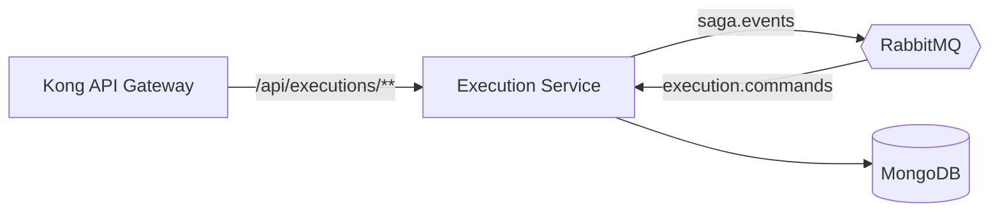

# Execution Service

Microsserviço de execução da oficina mecânica (Tech Challenge — Fase 4). Mantém a fila de trabalho da oficina: recebe as ordens para diagnóstico, registra o diagnóstico do mecânico, acompanha o reparo e comunica a finalização.

## Visão do serviço



O serviço não chama nenhum outro serviço e não lê nenhum outro banco. Os dados do veículo e da reclamação chegam no comando `execution.diagnosis.start`. Serviços e peças do diagnóstico são guardados só como referência e quantidade: nomes e preços pertencem ao OS Service.

### Por que MongoDB

Cada ordem de trabalho é um documento com seu histórico de andamento embutido, que só cresce. Não há junções: a fila é uma consulta por status ordenada pela data de entrada. O outbox usa transações do MongoDB, que exigem replica set (o Atlas sempre é um; o container local sobe como replica set de um nó).

### Participação na Saga

| Comando recebido | O que faz | Resposta |
|---|---|---|
| `execution.diagnosis.start` | Coloca a ordem na fila de diagnóstico | — |
| — (ação do mecânico) | Inicia e conclui o diagnóstico | `execution.diagnosis.started`, `execution.diagnosis.completed` |
| `execution.diagnosis.reopen` | Devolve o diagnóstico ao mecânico, com o motivo | — |
| `execution.repair.start` | Coloca a ordem na fila de reparo | — |
| — (ação do mecânico) | Inicia, conclui ou declara inviável o reparo | `execution.repair.started`, `execution.repair.completed` / `execution.repair.failed` |
| `execution.workorder.cancel` | Cancela o trabalho (compensação) | — |

Comandos são idempotentes: uma reentrega é reconhecida e ignorada. As respostas são gravadas em uma outbox na mesma transação da mudança de estado.

### Ciclo de vida da ordem de trabalho

`DIAGNOSIS_QUEUED` → `IN_DIAGNOSIS` → `AWAITING_APPROVAL` → `REPAIR_QUEUED` → `IN_REPAIR` → `COMPLETED`, ou `FAILED` (reparo inviável) ou `CANCELED` (Saga compensada). O reparo só pode começar depois que a Saga libera, isto é, depois de orçamento aprovado e pago.

A arquitetura do serviço (componentes, modelo de dados, ciclo de vida e participação na Saga) está em [docs/architecture.md](docs/architecture.md).

### Camadas

Pacote raiz `org.project.mechanic_shop.execution`, em arquitetura hexagonal:

- `domain/`: `WorkOrder` e suas regras de transição, enums e DTOs;
- `application/`: casos de uso (`services`), contratos da Saga (`saga`) e portas (`ports`);
- `infrastructure/`: documentos e repositórios MongoDB, outbox e RabbitMQ (`messaging`);
- `presentation/`: controller e tratamento de erros;
- `shared/config/`: segurança (JWT), observabilidade, MongoDB e Swagger.

## API

| Método e rota | Perfis | Descrição |
|---|---|---|
| `GET /api/executions?status=` | admin, recepção, mecânico | Fila, da mais antiga para a mais nova |
| `GET /api/executions/{serviceOrderId}` | admin, recepção, mecânico | Ordem de trabalho com histórico |
| `POST /api/executions/{serviceOrderId}/diagnosis/start` | mecânico, admin | Inicia o diagnóstico |
| `POST /api/executions/{serviceOrderId}/diagnosis/complete` | mecânico, admin | Registra diagnóstico, serviços e peças |
| `POST /api/executions/{serviceOrderId}/repair/start` | mecânico, admin | Inicia o reparo |
| `POST /api/executions/{serviceOrderId}/repair/complete` | mecânico, admin | Conclui o reparo |
| `POST /api/executions/{serviceOrderId}/repair/fail` | mecânico, admin | Declara o reparo inviável |

Swagger: `http://localhost:8082/api/executions/swagger-ui/index.html`. O JWT é o emitido pelo OS Service; o papel vem no claim `role`.

## Execução

Para subir os três serviços juntos, use o `docker-compose.full.yaml` do repositório `mechanic-shop-os-service` (com os três repositórios clonados lado a lado): `docker compose -f docker-compose.full.yaml up --build -d`. Para rodar só este serviço, ele precisa de um MongoDB em replica set e de um RabbitMQ:

```bash
./mvnw spring-boot:run
```

| Variável | Padrão | Uso |
|---|---|---|
| `MONGODB_URI` | `mongodb://localhost:27017/execution-db?replicaSet=rs0&directConnection=true` | Banco do serviço (local ou Atlas) |
| `RABBITMQ_HOST` / `_PORT` / `_USERNAME` / `_PASSWORD` | `localhost:5672`, guest | Broker da Saga |
| `JWT_SECRET`, `JWT_ISSUER` | — | Devem ser iguais aos do OS Service |

## Testes

```bash
./mvnw verify      # os testes de integração precisam de Docker (Testcontainers)
```

- Testes unitários de domínio, casos de uso, controller, segurança e infraestrutura.
- BDD em `src/test/resources/features/execucao_da_ordem_de_servico.feature` (7 cenários, da fila à conclusão).
- Testes de integração com MongoDB real: mapeamento, transação com rollback, outbox e segurança.
- O build falha se a cobertura de linhas ficar abaixo de 80%. Medição em 10/10/2026: **63 testes unitários + 5 de integração, 94,9% de linhas** nos unitários (`target/site/jacoco/index.html`).

## CI/CD

O workflow `.github/workflows/ci-cd.yml` roda `./mvnw verify` (com o gate de 80% de cobertura) em todo PR para `master`, publica o relatório de cobertura como artefato e, se o secret `SONAR_TOKEN` existir, faz a análise no SonarQube/SonarCloud com quality gate. No push para `master`, publica a imagem no Docker Hub e aplica `k8s/` no EKS, no namespace `mechanic-shop`.

O RabbitMQ, o Kong e o Mailpit do cluster são implantados pelo pipeline do OS Service; no primeiro deploy, rode-o antes deste. O Kong encaminha ``/api/executions/**`` para o Service ``execution-service:8082``.

| GitHub | Nome |
|---|---|
| Secrets | `AWS_ROLE_TO_ASSUME`, `DOCKERHUB_TOKEN`, `JWT_SECRET`, `MONGODB_URI` (MongoDB em replica set, ex.: Atlas), `RABBITMQ_USERNAME`, `RABBITMQ_PASSWORD`, `NEW_RELIC_LICENSE_KEY`, `SONAR_TOKEN` (opcional) |
| Variables | `AWS_REGION`, `DOCKERHUB_USERNAME`, `EKS_CLUSTER_NAME`, `NEW_RELIC_APP_NAME`, `SONAR_PROJECT_KEY`, `SONAR_ORGANIZATION`, `SONAR_HOST_URL` |

`JWT_SECRET` e `RABBITMQ_USERNAME`/`RABBITMQ_PASSWORD` precisam ter o mesmo valor nos três repositórios.
