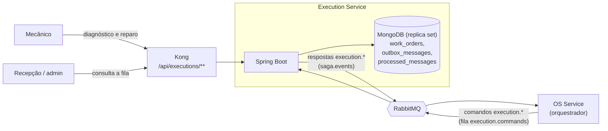
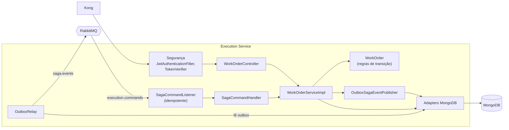
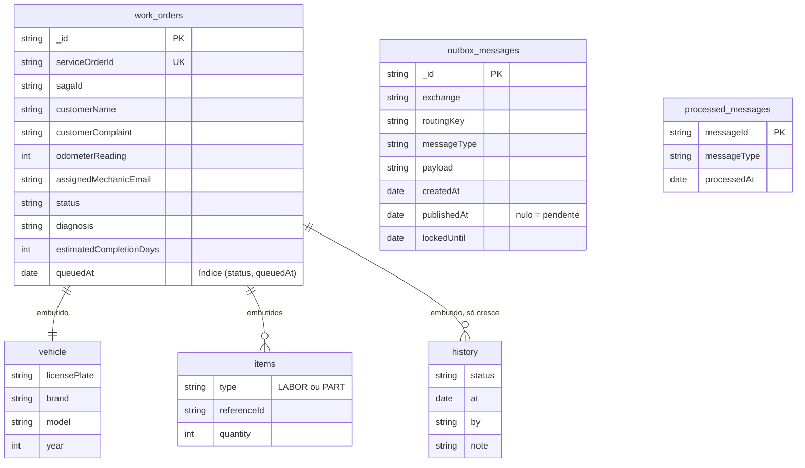
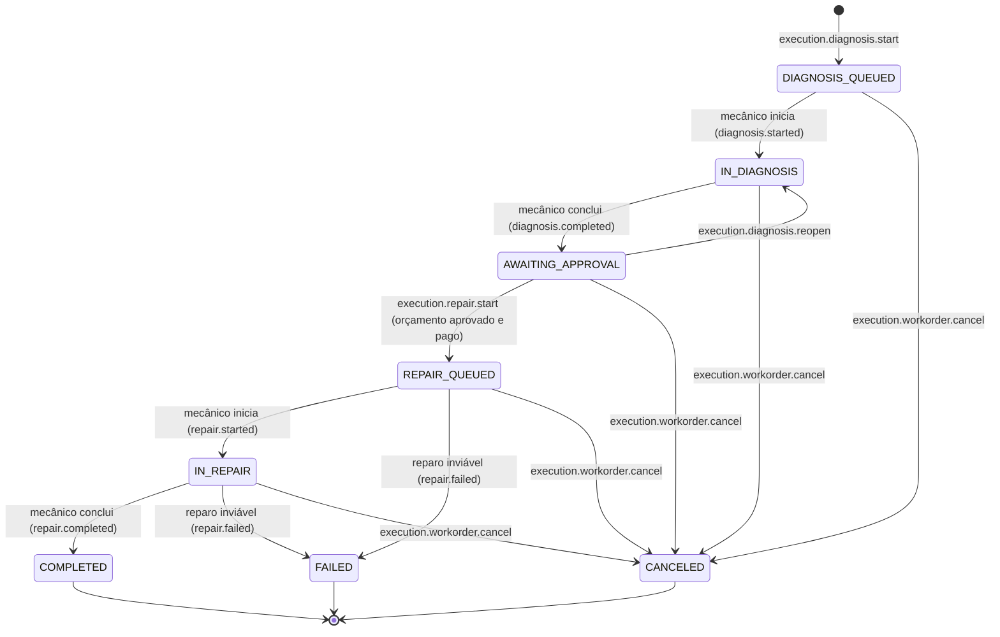
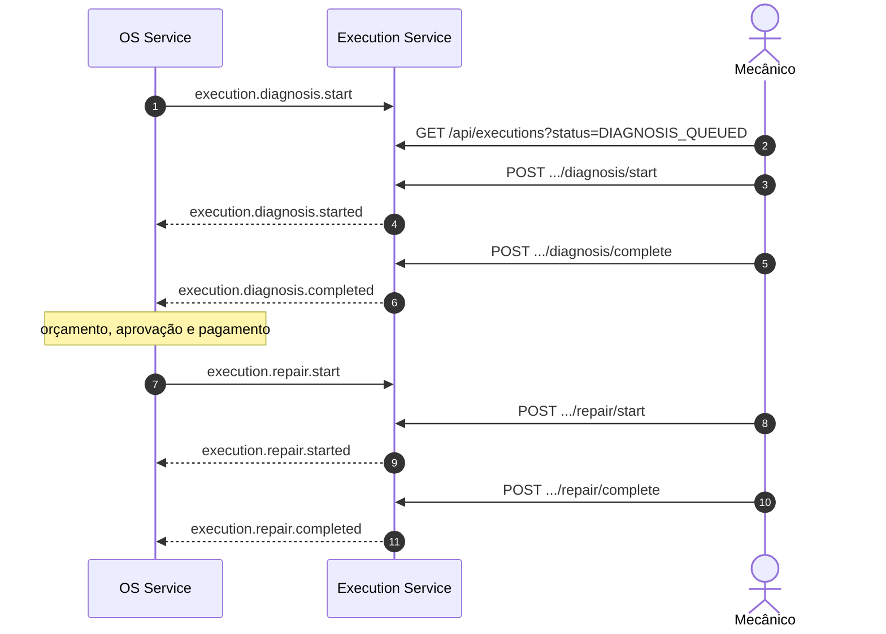

# Arquitetura do Execution Service

Microsserviço do chão de oficina. Mantém a fila de trabalho, registra o diagnóstico do mecânico, acompanha o reparo e comunica a finalização ao OS Service. Participa da Saga da ordem de serviço, orquestrada pelo OS Service. A visão do sistema inteiro (os três serviços, a Saga e a implantação) está no repositório do OS Service, em `docs/architecture/`.

## Contexto

O serviço não chama nenhum outro serviço e não lê nenhum outro banco. Os dados do veículo e da reclamação chegam no comando `execution.diagnosis.start`. Serviços e peças do diagnóstico são guardados só como referência e quantidade: nomes, preços e estoque pertencem ao OS Service, que precifica o orçamento.

## Componentes

| Componente | Responsabilidade |
|---|---|
| `SagaCommandListener` + `SagaCommandHandler` | Consome `execution.commands`, descarta reentregas (`processed_messages`) e despacha para o caso de uso |
| `WorkOrderServiceImpl` | Casos de uso da fila: enfileirar, iniciar e concluir diagnóstico, reabrir, enfileirar, iniciar, concluir ou declarar inviável o reparo, cancelar |
| `WorkOrder` | Agregado com as regras de transição de estado; cada mudança acrescenta uma entrada ao histórico |
| `OutboxSagaEventPublisher` + `OutboxRelay` | Grava a resposta da Saga na mesma transação MongoDB da mudança de estado e publica em `saga.events` |
| Segurança | Valida o JWT emitido pelo OS Service; as rotas são da equipe (admin, recepção e mecânico) |

## Modelo de documentos

## Ciclo de vida da ordem de trabalho

O reparo só pode começar depois que a Saga libera, isto é, depois do orçamento aprovado e pago. O mecânico não consegue pular essa etapa pela API. O cancelamento só tem efeito em ordens ativas; em `COMPLETED`, `FAILED` ou `CANCELED`, é ignorado.

## Participação na Saga

| Comando recebido | Ação | Resposta |
|---|---|---|
| `execution.diagnosis.start` | Coloca a ordem na fila de diagnóstico | — |
| — (mecânico) | Inicia e conclui o diagnóstico, com serviços e peças | `execution.diagnosis.started`, `execution.diagnosis.completed` |
| `execution.diagnosis.reopen` | Devolve o diagnóstico ao mecânico, com o motivo | — |
| `execution.repair.start` | Coloca a ordem na fila de reparo | — |
| — (mecânico) | Inicia, conclui ou declara inviável o reparo | `execution.repair.started`, `execution.repair.completed` / `execution.repair.failed` |
| `execution.workorder.cancel` | Cancela o trabalho (compensação) | — |

## Decisões

- **MongoDB (o banco NoSQL do sistema):** cada ordem de trabalho é um documento autocontido, com veículo, itens e histórico embutidos, e o histórico só cresce. Não há junções: a fila é uma consulta por status ordenada pela data de entrada, atendida pelo índice `(status, queuedAt)`.
- **Replica set:** a outbox usa transações multi-documento do MongoDB, que exigem replica set. O Atlas sempre é um; localmente o container sobe como replica set de um nó.
- **Outbox com trava:** `lockedUntil` impede que duas réplicas publiquem a mesma mensagem ao mesmo tempo.
- **Snapshot em vez de consulta:** os dados do veículo são copiados no comando. O serviço continua funcionando mesmo com o OS Service fora do ar.

## Observabilidade

Logs estruturados em JSON (perfil `prod`), `correlationId` lido das mensagens e propagado no MDC e no New Relic, e eventos `MechanicShopSagaFailure` e `MechanicShopIntegrationFailure` para falhas de passo e de integração.
